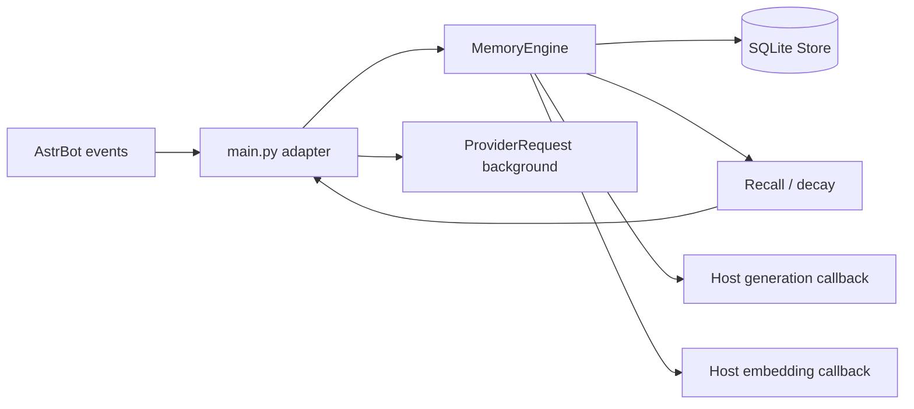

# Architecture and host API



## Module boundaries

- `main.py`: AstrBot lifecycle, scope mapping, event deduplication, configuration, tools and commands.
- `human_brain_memory/engine.py`: capture, retrieval budget, episodes, daily consolidation, retry and followups.
- `store.py`: SQLite schema, scoped lookups, transactions/savepoints, snapshots, undo and backup.
- `recall.py`: Chinese token overlap, cosine scoring, retention, bounded reinforcement, state transitions.
- `config.py`: validated typed core configuration. `_conf_schema.json` supplies AstrBot settings.

## Host contract

```python
async def generate(scope: str, system: str, prompt: str) -> str:
    # Return the model's JSON text. Do not expose tools to this background call.
    ...

async def embed(texts: list[str]) -> list[list[float]]:
    # Return finite vectors of equal dimension, in input order.
    ...

engine = MemoryEngine(store, generate=generate, embed=embed,
                      model_key="provider-id:model-name:revision")
```

Call `record(scope, origin, provider, event_key, role, subject, name, content)` for user and assistant
messages; event keys must be stable on retries. Role is `user` or `assistant`. Subjects are opaque
strings; reserved `@self` denotes the bot and `@scene` denotes an episode/gist.

Before a reply, call `await context(scope, subject, query)`, or `await recall(...)` for structured results.
Call `await maintain(scope)` periodically; it processes at most one batch per stage and serializes
maintenance across sessions. The host owns worker cancellation and `store.close()`.
Callbacks are cancellation-safe at the engine boundary: unfinished model calls do not advance cursors.
Synchronous SQLite transactions must never contain `await`.

The `explicit=True` argument of `remember()` and `replace_explicit()` is a **trusted host action**;
never expose it as a model-supplied parameter. The AstrBot adapter only uses it in direct user commands.
Quote storage requires a current user message, its ID, and content equal to the entire message.

## Isolation

Scope is assigned by the host, not the model. All candidates, evidence IDs, profiles, followups,
run IDs and management operations are checked in that scope. Deduplication includes scope, subject,
kind and text; identical text in a private chat cannot reuse a public row.
The default AstrBot adapter uses `[platform_instance_id, bot_account_id, unified_msg_origin]`.
Changing AstrBot's session-isolation configuration can therefore change which memory scope is used.

Generated summaries are always inferences. They can supersede older inferences for the same person,
but never confirmed facts. Exact quotes preserve logical meaning without pretending semantic similarity
is a truth check. This is deliberately conservative; arbitrary inference accuracy is not guaranteed.

## Processing and recovery

Episode and consolidation cursors are separate, monotonic message IDs. Each stage validates its entire
JSON result before writing, then commits its generated records, journal and cursor atomically.
Successful stages remain complete when a later stage fails. Failures retry with exponential backoff
(2 minutes initially, capped at 6 hours), including after restart; manual consolidation bypasses backoff.
No automatic “failed three times, skip this batch” behavior is used.

Daily processing uses the configured IANA timezone and bounded batches. New sessions wait for their
first scheduled night. Long-running conversations are still processed during nightly consolidation.

Undo is a compensating operation on derived records, not raw messages or cursor rollback. If any
affected row changed after the batch (including recall metadata), the entire undo is refused.
This favors preserving later changes over silently undoing unrelated user work.

## SDK evidence

Adapter hooks and signatures were checked against AstrBot **4.29.3**, source commit
`dad255c60f7983fd63c7c0282ded1dde859fbc9a`:

- `astrbot.api.star`: `Star`, `Context`, `StarTools.get_data_dir`.
- `Context.llm_generate(chat_provider_id=..., system_prompt=..., prompt=...)`.
- `Context.get_current_chat_provider_id(umo)` and `get_provider_by_id(id)`.
- `EmbeddingProvider.get_embeddings(texts)` and `get_model()`.
- `filter.on_llm_request`, `on_llm_response`, `event_message_type`, `llm_tool`, `command`.
- `ProviderRequest.system_prompt` and `LLMResponse.completion_text`.

Source reference: https://github.com/AstrBotDevs/AstrBot/tree/dad255c60f7983fd63c7c0282ded1dde859fbc9a

Contract tests use a minimal fake SDK. They verify our adapter behavior and signatures, not the entire
AstrBot loader or every platform adapter. See the publishing guide for live smoke checks.
